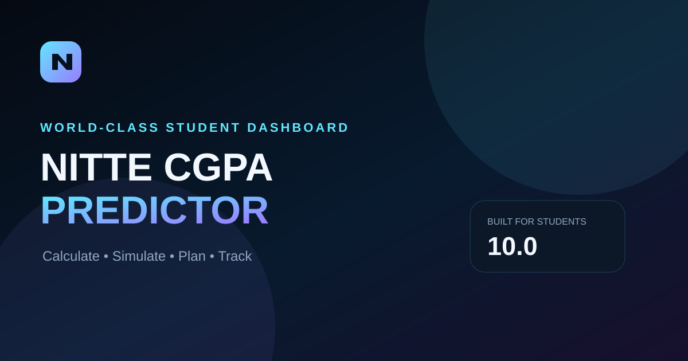

# 🎓 NITTE CGPA Predictor

> **Calculate. Simulate. Plan. Track.**  
> A privacy-first, mobile-first academic dashboard for NITTE students.

[](#-github-pages)
[](#-privacy-first)
[](#-project-structure)

NITTE CGPA Predictor turns semester marks into an interactive planning workspace. Instead of only showing a number, it helps students understand **where they are, where they can go, and what marks they need next**.

---

## ✨ Highlights

- ⚡ Live SGPA and CGPA calculation
- 🎯 Target SGPA planning
- 🔮 What-if / scenario simulation
- 📊 Subject-level performance intelligence
- 🧮 Credit-weighted calculations
- 🏆 Best-case and current-case comparisons
- 📚 Semester/history tracking
- 💾 Local autosave
- 📤 Export / import support
- 🖨️ Print-friendly result view
- 📱 Responsive mobile-first interface
- 🌗 Theme support
- 🔒 No account, analytics, external scripts, or mark-upload server required

---

## 🖼️ Screenshots

### Command Center


### Social / Link Preview



> Replace or supplement these SVG previews with browser screenshots from your deployed GitHub Pages site if you want a photo-real UI showcase.

---

## 🚀 Run locally

No build system is required.

```bash
git clone https://github.com/YOUR-USERNAME/nitte-cgpa-predictor.git
cd nitte-cgpa-predictor
```

Then open `index.html` in a browser.

For a local server:

```bash
python -m http.server 8000
```

Open:

```text
http://localhost:8000
```

---

## 🌐 GitHub Pages

1. Push this repository to GitHub.
2. Open **Settings → Pages**.
3. Choose **Deploy from a branch**.
4. Select `main` and `/ (root)`.
5. Save.

Your site will be available at:

```text
https://YOUR-USERNAME.github.io/nitte-cgpa-predictor/
```

---

## 🔐 Privacy-first

The application is designed to keep student marks in the browser.

- No login required
- No external analytics
- No mark-upload API
- No database required
- Local browser persistence
- Export/import can be handled by the user

**Important:** the academic calculation scheme should always be checked against the student's official NITTE course/assessment scheme before using the output for academic decisions.

---

## 📁 Project structure

```text
nitte-cgpa-predictor/
├── index.html
├── favicon.svg
├── manifest.webmanifest
├── og-preview.svg
├── screenshots/
│   └── dashboard.svg
└── README.md
```

---

## 🎨 Design philosophy

The interface is intentionally designed around four ideas:

**Clarity** — the most important academic numbers are immediately visible.

**Actionability** — the app answers “what should I do next?” rather than only calculating a score.

**Privacy** — student marks should not need to leave the device.

**Progress** — semester performance should feel like a trajectory, not an isolated number.

---

## 🧮 Calculation model

The application uses the grading and assessment assumptions encoded in the calculator. Because university assessment schemes can vary by course or regulation, users should verify the official scheme before relying on a result.

---

## 🛠️ Customization

The project is intentionally lightweight. You can customize:

- grading thresholds
- assessment weights
- default subjects
- branding
- colors
- dashboard cards
- target-planning logic
- result export format

No framework or package manager is required for the current version.

---

## 📌 Roadmap

Potential future upgrades:

- [ ] Full PWA install experience
- [ ] Configurable grading schemes
- [ ] Course/semester templates
- [ ] Richer historical charts
- [ ] Shareable result cards
- [ ] Accessibility audit
- [ ] Automated calculation test suite
- [ ] Optional cloud sync

---

## 📄 License

Choose the license that matches how you want others to use the project.

For a personal/student project, **MIT** is a simple permissive option. If you want to protect the branding and prevent reuse of the product identity, consider keeping the name/logo under your own terms even if the code is open.

---

## 👤 Author

Built as a student-focused academic planning experience for NITTE.

**NITTE CGPA Predictor — Know your next move.**
